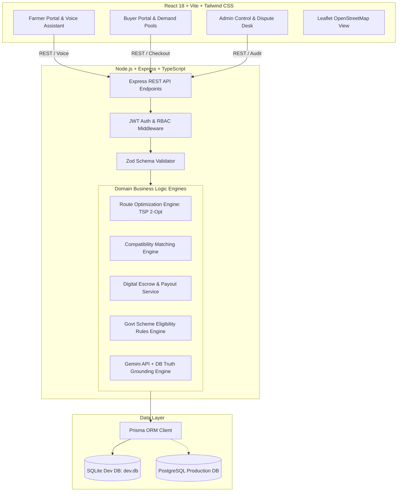

# AGRIBridge System Architecture & Algorithmic Blueprint

## 1. System Vision & Problem Formulation
In traditional Indian agricultural supply chains, small and marginal farmers (comprising over 86% of the farming demographic) face a critical market failure:
- **Quantity Fragmentation**: Smallholders produce quantities too small (e.g., 50 kg – 200 kg) to attract direct institutional B2B wholesale buyers.
- **Intermediary Extraction**: Up to 4–6 layers of village aggregators, commission agents, APMC middlemen, and transporters siphon 40%–55% of the final consumer value.
- **Logistics Disconnect**: Dispatching individual 100 kg farm pickups is economically non-viable.

**AGRIBridge** solves this through algorithmic two-sided aggregation:
1. **Supply Aggregation**: Dynamic geographic pooling of identical crops and quality grades from smallholders into unified wholesale batches.
2. **Demand Aggregation**: Shared bulk purchasing for small food processors, restaurants, and grocers to unlock farm-gate bulk pricing.
3. **Multi-Stop Logistics Optimization**: Heuristic TSP pickup routes (Haversine + Nearest Neighbor + 2-Opt) collecting produce farm-by-farm and delivering directly to the buyer hub.
4. **Conditional Dual Confirmation Escrow**: Zero payment default risk; funds locked in escrow prior to pickup and released upon joint buyer-driver receipt confirmation.

---

## 2. High-Level Component Architecture



---

## 3. Algorithmic Deep Dive: Logistics & Route Optimization

### Problem Formulation
Given:
- $N$ farm locations $F_1, F_2, \dots, F_N$, where each farm $F_i$ has coordinates $(\text{lat}_i, \text{lon}_i)$ and committed quantity $q_i$.
- One buyer fulfillment hub destination $D = (\text{lat}_D, \text{lon}_D)$.
- A vehicle with maximum capacity $C$ where $\sum_{i=1}^N q_i \le C$.

Find a permutation of stops $\pi = (F_{\pi(1)}, F_{\pi(2)}, \dots, F_{\pi(N)})$ that minimizes total transit distance:
$$\min \sum_{i=1}^{N-1} d(F_{\pi(i)}, F_{\pi(i+1)}) + d(F_{\pi(N)}, D)$$

### Algorithmic Pipeline
1. **Haversine Distance Metric**:
   $$d = 2R \arcsin\left(\sqrt{\sin^2\left(\frac{\Delta \phi}{2}\right) + \cos(\phi_1)\cos(\phi_2)\sin^2\left(\frac{\Delta \lambda}{2}\right)}\right)$$
   Where $R = 6371\text{ km}$, $\phi$ is latitude in radians, and $\lambda$ is longitude in radians. Road tortuosity correction factor $\tau = 1.25$ is applied to approximate road curves from great-circle distances.

2. **Nearest-Neighbor Initial Heuristic (Greedy TSP)**:
   - Begin at the farm furthest from the buyer hub (or centroid).
   - Iteratively visit the closest unvisited farm until all stops are sequenced.

3. **2-Opt Local Search Heuristic**:
   - For every pair of edges $(i, i+1)$ and $(j, j+1)$ along the tour:
   - If reversing the sub-sequence from $i+1$ to $j$ reduces total tour distance:
     $$\Delta d = (d(i, j) + d(i+1, j+1)) - (d(i, i+1) + d(j, j+1)) < 0$$
   - Reverse the sub-tour and repeat until no 2-opt improvements can be found (local optimum reached).

4. **Capacity & Cost Projection**:
   - Estimated fuel and transport cost:
     $$\text{Cost} = \text{Base Fare} + (\text{Total Km} \times \text{Per Km Rate}) + (\text{Stops} \times \text{Per Stop Handling Fee})$$

---

## 4. Algorithmic Deep Dive: Multi-Criteria Compatibility Matching

When a Buyer posts a `PurchaseRequirement` or a Farmer forms a `SupplyPool`, the matching engine calculates a normalized compatibility score $S \in [0, 100]$:

$$S = w_c \cdot S_{\text{crop}} + w_q \cdot S_{\text{quantity}} + w_p \cdot S_{\text{price}} + w_d \cdot S_{\text{distance}} + w_g \cdot S_{\text{grade}}$$

- **Crop Matching ($S_{\text{crop}}$)**: Binary $1.0$ if identical crop, else $0.0$.
- **Quantity Compatibility ($S_{\text{quantity}}$)**: Ratio of pooled volume to requested volume:
  $$S_{\text{quantity}} = \min\left(1.0, \frac{Q_{\text{pool}}}{Q_{\text{required}}}\right)$$
- **Price Overlap ($S_{\text{price}}$)**: Difference between buyer budget cap $P_{\text{buyer}}$ and pool minimum acceptable price $P_{\text{pool}}$:
  $$S_{\text{price}} = \max\left(0, 1.0 - \frac{P_{\text{pool}} - P_{\text{buyer}}}{P_{\text{buyer}}}\right)$$
- **Geographic Proximity ($S_{\text{distance}}$)**: Haversine distance penalty decaying over $150\text{ km}$.
- **Quality Grade ($S_{\text{grade}}$)**: Strict equality or grade tier adjustment.

Pairs with $S \ge 70$ are surfaced as recommended wholesale contract candidates.

---

## 5. Security & Digital Escrow Protocol

```mermaid
sequenceDiagram
    autonumber
    actor Buyer
    participant Escrow as Platform Escrow Engine
    participant Driver as Logistics Transporter
    actor Farmer
    
    Buyer->>Escrow: Deposit Order Funds (UPI / Card / NetBanking)
    Escrow->>Escrow: Status -> HELD_IN_ESCROW
    Note over Escrow: Funds locked securely; cannot be withdrawn unilaterally
    
    Driver->>Farmer: Arrives at farm gate with handheld digital scale
    Farmer->>Driver: Produce inspected & weighed
    Farmer->>Escrow: Farmer Confirms Pickup in App
    Note over Driver,Farmer: Stage 1 Verified: farmerPickupConfirmed = true
    
    Driver->>Buyer: Truck arrives at Buyer Hub
    Buyer->>Buyer: Produce inspected for grade & weight
    Buyer->>Escrow: Buyer Confirms Delivery Receipt in App
    Note over Buyer,Escrow: Stage 2 Verified: buyerDeliveryConfirmed = true
    
    Escrow->>Farmer: Automated Split Payout credited directly to Farmer Bank Accounts
    Escrow->>Escrow: Status -> RELEASED_TO_FARMERS
```

---

## 6. AI Truth Grounding Architecture

To protect farmers from hallucinations or outdated advice:
- The system executes a mandatory database query retrieving actual APMC mandi feeds, active supply pools, and verified government scheme rules before calling the LLM.
- The Gemini API prompt is strictly structured with factual records in system instructions.
- Responses clearly format and distinguish:
  - `[DATABASE FACT]`: Grounded, unalterable price records and scheme criteria.
  - `[AI EXPLANATION]`: Synthesized advisory language translated to the user's preferred tongue (Tamil, Hindi, English).
  - `[USER INPUT]`: Farmer/buyer queries.
- In offline or API-key-free mode, the platform seamlessly uses a deterministic database facts synthesizer ensuring 100% uptime.
