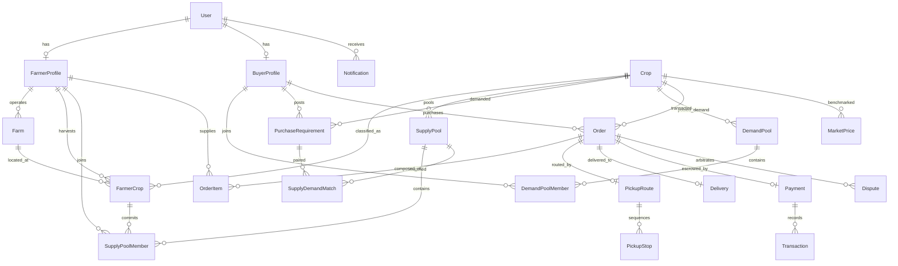

# AGRIBridge Database Design & Schema Architecture

## 1. Overview
AGRIBridge employs a normalized relational schema designed to support high-integrity agricultural aggregation, matching, multi-stop routing logistics, and escrow payment processing. The database models both supply-side (Farmer) and demand-side (Buyer) workflows seamlessly.

---

## 2. Core Entities & Relationships

### Identity & Access Management
- **`User`**: Central authentication record with role-based access (`FARMER`, `BUYER`, `ADMIN`).
- **`FarmerProfile`**: 1-to-1 extension of `User` for farmers. Tracks total acreage, bank details, and preferred language.
- **`BuyerProfile`**: 1-to-1 extension of `User` for buyers. Tracks business name, type, GSTIN, and delivery hub coordinates.
- **`Notification`**: In-app notifications tied to users.

### Agricultural Master & Inventory
- **`Crop`**: Master catalog of crops (category, perishability, shelf life, unit, local multilingual names).
- **`Farm`**: Physical land parcels owned by a farmer with exact geographic coordinates (`latitude`, `longitude`).
- **`FarmerCrop`**: Farm-level inventory batches with available quantity, allocated quantity, harvest date, and quality grade.

### Supply & Demand Aggregation Pools
- **`SupplyPool`**: Aggregation vehicle pooling produce across multiple small farmers in a district to satisfy bulk contracts.
- **`SupplyPoolMember`**: Membership record linking a farmer's crop inventory lot to a supply pool.
- **`PurchaseRequirement`**: Buyer-posted procurement demands specifying crop, volume, price cap, and delivery target.
- **`DemandPool`**: Aggregation vehicle pooling requirements across multiple small buyers to unlock wholesale volume pricing.
- **`DemandPoolMember`**: Membership record linking a buyer's purchase requirement to a demand pool.
- **`SupplyDemandMatch`**: Compatibility score calculated by the matching engine between supply pools and purchase requirements.

### Orders, Logistics & Financial Escrow
- **`Order`**: Legally binding wholesale contract between buyers and aggregated farmers. Tracks dual confirmation status.
- **`OrderItem`**: Line-item representing each contributing farmer's lot in the order.
- **`PickupRoute`**: Optimized multi-stop route generated via Nearest-Neighbor and 2-Opt TSP algorithms.
- **`PickupStop`**: Ordered sequential stops along the pickup route with farm coordinates and collection quantity.
- **`Delivery`**: Final destination hub record for the order.
- **`Payment`**: Financial escrow ledger holding funds securely until both pickup and delivery are confirmed.
- **`Transaction`**: Immutable ledger of deposits, locks, releases, and disbursements.
- **`Dispute`**: Trust and arbitration record filed for quality discrepancies or quantity mismatches.

### Market Intelligence & Government Policy
- **`MarketPrice`**: Mandi price records benchmarked against APMC feeds across districts.
- **`GovernmentScheme`**: Central and state welfare initiatives with rules for automated farmer eligibility evaluation.

---

## 3. Schema Diagram (ERD)

---

## 4. Multi-Database Support (SQLite & PostgreSQL)

1. **Development Environment**: SQLite (`backend/dev.db`) using standard Prisma ORM configuration for zero-setup execution.
2. **Production Environment**: PostgreSQL (`prisma/schema.postgresql.prisma` and `docker-compose.yml`) utilizing high-concurrency connection pooling, native decimal types, and JSONB indexing for geospatial coordinates.
