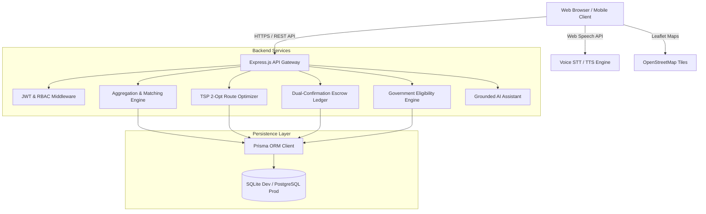

# AGRIBridge 🌱🚛
### Direct B2B Agricultural Marketplace & Supply/Demand Pooling Platform

[](https://www.typescriptlang.org/)
[](https://reactjs.org/)
[](https://vitejs.dev/)
[](https://nodejs.org/)
[](https://www.prisma.io/)
[](https://tailwindcss.com/)
[](https://leafletjs.com/)

---

## 🌾 Project Overview

**AGRIBridge** is a full-stack, production-grade B2B agricultural platform engineered to solve the fundamental fragmentation problem in agricultural supply chains. 

Small and marginal farmers often harvest produce quantities (e.g. 50 kg – 200 kg) that are too small to individually fulfill the minimum order quantities (MOQ) demanded by bulk buyers such as supermarket chains, food processing units, hotels, restaurants, and exporters. Simultaneously, independent small businesses and restaurants struggle to access farm-gate wholesale prices.

AGRIBridge bridges this gap through two foundational aggregation mechanics:
1. **Supply Aggregation (Farmer Pooling)**: Micro-harvests from neighboring farms within a geographic radius are aggregated into standardized wholesale batches with automated multi-stop pickup logistics.
2. **Demand Aggregation (Buyer Pooling)**: Small-scale institutional buyers pool recurring demand to achieve bulk volume tier discounts.

---

## ✨ Key Capabilities & System Innovations

### 1. 🚜 Supply Pooling Engine
* Enables smallholder farmers within a geographic cluster to combine identical crop grades into a single verifiable bulk lot (e.g., 100 kg + 150 kg + 250 kg = 500 kg batch).
* Enforces strict quality grade matching (A, B, C, Export) and automatic pool status state transitions (`OPEN` → `LOCKED` → `ALLOCATED` → `FULFILLED`).

### 2. 🏢 Demand Pooling Engine
* Small restaurants, cafes, and retailers combine purchasing quotas to unlock farm-gate wholesale rates.
* Automatic price tier calculation based on aggregate pool volume with progress tracking toward target fulfillment.

### 3. 🗺️ Intelligent Logistics & TSP Route Optimizer
* Custom heuristic routing engine using **Haversine Distance Metric**, **Greedy Nearest-Neighbor**, and **2-Opt Local Search Optimization** to solve the Traveling Salesperson Problem (TSP) for farm pickups.
* Calculates optimal pickup sequence, cumulative distance, turnaround duration, vehicle capacity load factors, and estimated fuel costs.
* Interactive map visualization powered by Leaflet & OpenStreetMap with waypoint badges, pickup tags, and dynamic route polylines.

### 4. 🔒 Dual-Confirmation Digital Escrow System
* Built-in escrow ledger securing buyer funds upon order placement.
* Funds are strictly protected in `HELD_IN_ESCROW` status until **both parties** verify transaction fulfillment (dual PIN/confirmation code verification upon physical handover).
* Automated settlement payout to farmers' verified bank accounts upon delivery confirmation.

### 5. 📊 Real-Time APMC Mandi Price Benchmarks
* Crop price index tracking daily arrivals, minimum, maximum, and modal wholesale rates across agricultural produce market committees.
* Price trend indicators (bullish/bearish) allowing farmers and buyers to negotiate fair, transparent contracts.

### 6. 🏛️ Automated Government Scheme Eligibility Engine
* Deterministic rules engine checking state-wise agricultural subsidies, PM-KISAN, PMFBY, solar pump subsidies, and credit schemes.
* Evaluates landholding size (marginal/small/medium), state jurisdiction, and category to calculate instant eligibility percentages with actionable requirements.

### 7. 🗣️ Multilingual Voice-First Accessibility
* Built-in voice recognition and synthesis engine leveraging the Web Speech API (`SpeechRecognition` & `SpeechSynthesis`).
* Full multi-dialect support for **English**, **Tamil (தமிழ்)**, and **Hindi (हिन्दी)**.
* Allows rural farmers to navigate listings, check prices, and submit inquiries hands-free.

### 8. 🤖 Truth-Grounded AI Farm & Trade Assistant
* Context-aware conversational AI assistant integrated directly into both Farmer and Buyer portals.
* Grounded in live database facts (real active crops, verified APMC prices, platform order statistics) to prevent hallucinations.

### 9. ⚖️ Trust & Dispute Arbitration System
* Reputation scoring engine for both farmers and buyers based on completed transactions and verified ratings.
* Built-in arbitration portal allowing administrators to review evidence, hold hearings, and execute escrow refunds or releases.

---

## 🏛️ System Architecture



For in-depth architectural and operational details, refer to:
* 🚀 [Production Deployment Guide](file:///c:/Users/Oviya/OneDrive/Documents/Agri-Bridge/DEPLOYMENT.md)
* 📐 [Architecture Blueprint](file:///c:/Users/Oviya/OneDrive/Documents/Agri-Bridge/ARCHITECTURE.md)
* 🗄️ [Database Schema & ERD](file:///c:/Users/Oviya/OneDrive/Documents/Agri-Bridge/DATABASE_DESIGN.md)
* 📡 [REST API Documentation](file:///c:/Users/Oviya/OneDrive/Documents/Agri-Bridge/API_DOCUMENTATION.md)

---

## ☁️ Target Production Architecture

| Layer | Service / Provider | Configuration / Entry Point |
| :--- | :--- | :--- |
| **Frontend** | [Vercel](https://vercel.com/) | Vite React SPA, root dir `frontend`, SPA routing via `vercel.json` |
| **Backend** | [Render](https://render.com/) | Web Service (Node.js), root dir `backend`, Blueprint via `render.yaml` |
| **Database** | [Neon](https://neon.tech/) | Serverless PostgreSQL 16 with PgBouncer connection pooling |
| **Migrations** | Prisma 5.22 | PostgreSQL migration history in `backend/prisma/migrations/` |
| **Source Control** | [GitHub](https://github.com/) | Automated continuous delivery on push to `main` |

---

## 🔑 Pre-Seeded Demo Credentials (Development Only)

The platform is pre-loaded with realistic production data, including 12 crops, 17 users, 5 government schemes, active APMC prices, active pools, route plans, and escrow transactions.

| Role | Email | Password | Primary Features to Explore |
| :--- | :--- | :--- | :--- |
| **Farmer** 👨‍🌾 | `farmer@agribridge.demo` | `Farmer@123` | Produce listings, Supply Pools, Route map, Scheme matcher, Voice assistant |
| **Buyer** 🏢 | `buyer@agribridge.demo` | `Buyer@123` | Procurement requests, Demand Pools, Escrow checkout, Live order tracking |
| **Admin** 🛡️ | `admin@agribridge.demo` | `Admin@123` | Platform GMV metrics, User verification, Dispute arbitration panel |

---

## 🚀 Getting Started

### Prerequisites
* **Node.js** >= 18.0.0
* **npm** >= 9.0.0

### Quick Start (Single Command)

From the project root:

```bash
# 1. Install all dependencies across backend and frontend
npm run install:all # or cd backend && npm install && cd ../frontend && npm install

# 2. Setup backend database, run migrations, and seed demo scenarios
cd backend
npm run prisma:generate
npm run prisma:migrate
npm run prisma:seed
cd ..

# 3. Launch both Backend & Frontend simultaneously
npm run dev
```

* **Frontend URL**: `http://localhost:5173`
* **Backend API URL**: `http://localhost:5000`
* **Health Check**: `http://localhost:5000/api/health`
* **Database Readiness**: `http://localhost:5000/api/health/ready`

### Production Commands (Render / Cloud)
```bash
# Backend Build (Dynamically prepares schema based on DATABASE_URL, generates Prisma, compiles TS)
cd backend
npm run build:prod

# Production Migration Deployment (Applies committed DDL without data loss)
npm run prisma:deploy

# Production Server Start (Binds to 0.0.0.0 on assigned PORT)
npm run start

# Frontend Production Build (Outputs to frontend/dist)
cd ../frontend
npm run build
```

---

## 📦 Directory Structure

```text
Agri-Bridge/
├── backend/
│   ├── prisma/
│   │   ├── schema.prisma              # SQLite schema (Development)
│   │   ├── schema.postgresql.prisma   # PostgreSQL schema (Production)
│   │   ├── seed.ts                    # Realistic demo seed generator
│   │   └── migrations/                # Database migrations
│   ├── src/
│   │   ├── controllers/               # Express request handlers
│   │   ├── middleware/                # JWT auth & role validation
│   │   ├── routes/                    # API route definitions (14 modules)
│   │   ├── services/                  # Business logic (TSP, Escrow, AI)
│   │   ├── __tests__/                 # Vitest business logic unit tests
│   │   └── server.ts                  # Server entrypoint
│   └── package.json
│
├── frontend/
│   ├── src/
│   │   ├── components/                # Shared UI (Navbar, MapRouteView, Modals)
│   │   ├── context/                   # AuthContext & LanguageContext
│   │   ├── locales/                   # English, Tamil, Hindi dictionaries
│   │   ├── pages/                     # Public, Farmer, Buyer & Admin views
│   │   ├── App.tsx                    # Route definitions & ProtectedRoute guards
│   │   ├── index.css                  # Tailwind styles & theme variables
│   │   └── main.tsx                   # React root entrypoint
│   ├── index.html
│   ├── tailwind.config.js
│   ├── vite.config.ts
│   └── package.json
│
├── ARCHITECTURE.md                    # Technical architecture & math specs
├── DATABASE_DESIGN.md                 # Entity relationship diagrams & data dictionary
├── API_DOCUMENTATION.md               # Endpoints, payloads & response schemas
├── docker-compose.yml                 # Production PostgreSQL container setup
└── README.md                          # Project documentation
```

---

## 🧪 Running Automated Tests

AGRIBridge includes end-to-end automated test suites verifying business logic rules (TSP route optimization, compatibility scoring, escrow ledger invariants, and commission deductions):

```bash
cd backend
npm run test
```

---

## ⚠️ Regulatory & Operational Disclaimers

> [!NOTE]
> **Market Pricing Disclaimer**: Market information shown in this demo is sample data and should not be treated as live market pricing.

> [!IMPORTANT]
> **Government Schemes Disclaimer**: Scheme eligibility shown here is an informational estimate. Eligibility and application requirements may change. Verify details on the official government portal before applying.

> [!WARNING]
> **Logistics Estimation Disclaimer**: Route shown is an optimization estimate and may differ from actual road conditions.

---

## 📄 License
This project is open-source under the MIT License. Developed for agricultural empowerment and sustainable food supply chains.
